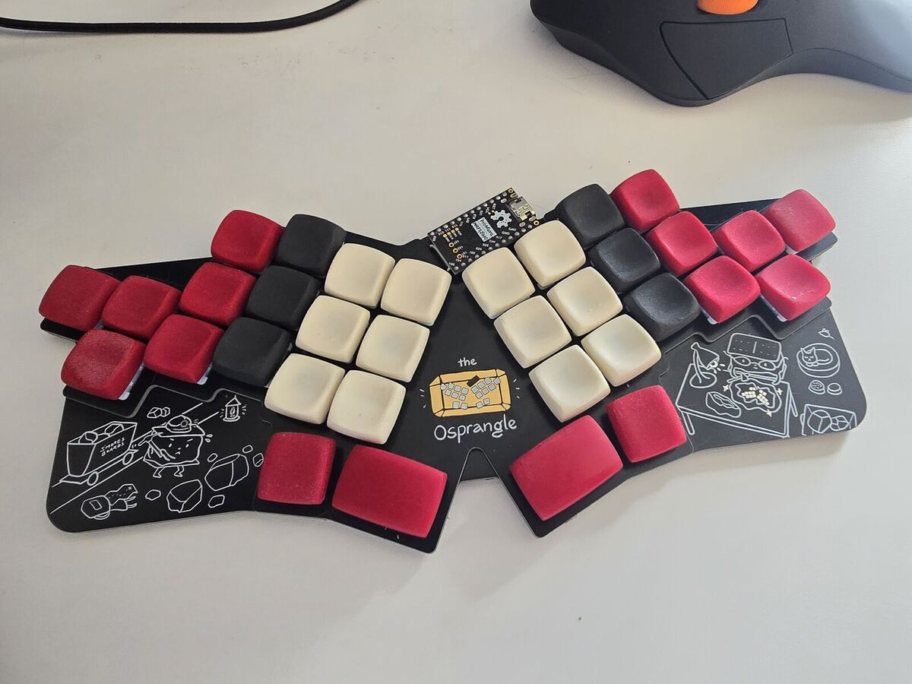
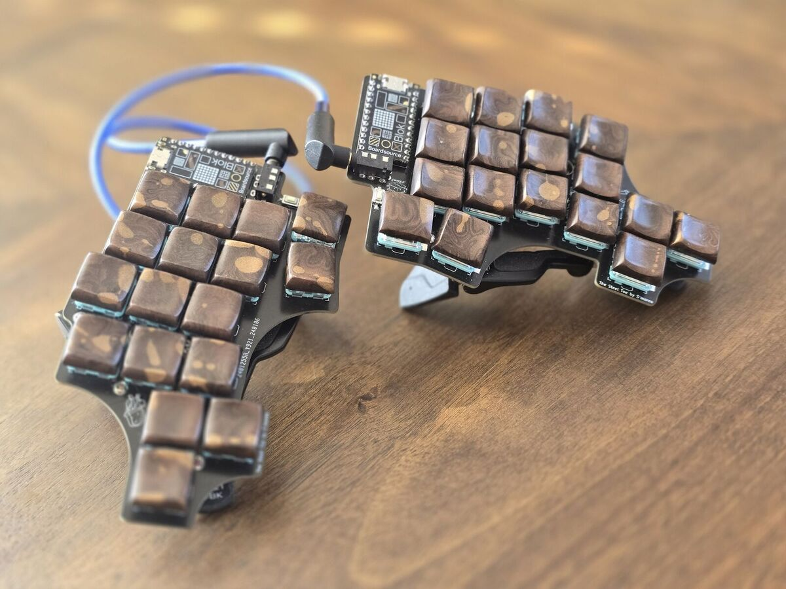

Keyboards
=========

I design open-source 34-key columnar keyboards with pinky clusters. The design
files, ordering notes, and pictures live with each board, and everything is MIT
licensed.

There are two families. Every board in a family shares the same layout and
firmware, so each family lives in one repo with a folder per board.

# The Osprette family

Unibody boards, from the original through the hotswap Osprangle and the tiny
Roadkill.

| Board | Switches | Controller | Notes |
| --- | --- | --- | --- |
| [Osprette](https://github.com/smores56/osprette/tree/main/v1) | Choc V1 | Pro Micro | the original |
| [Osprette V2](https://github.com/smores56/osprette/tree/main/v2) | Choc V1 | Pro Micro | nicer case, optional hotswap |
| [Osprette V3](https://github.com/smores56/osprette/tree/main/v3) | Choc V1 | Pro Micro | direct solder |
| [Osprette MX](https://github.com/smores56/osprette/tree/main/mx) | MX | Pro Micro | MX version |
| [Osprangle](https://github.com/smores56/osprette/tree/main/osprangle) | Choc V2 | Pro Micro | hotswap |
| [Roadkill](https://github.com/smores56/osprette/tree/main/roadkill) | Kailh PG1316S | Pro Micro | butterfly switches |

# The Clog family

Split boards, the split version of the Osprette.

| Board | Switches | Controller | Notes |
| --- | --- | --- | --- |
| [Clog](https://github.com/smores56/clog/tree/main/v1) | Choc V1 | Pro Micro | the original split |
| [Clog V2](https://github.com/smores56/clog/tree/main/v2) | Choc V1 | Xiao BLE | wireless only, splay, roller |
| [Clog V3](https://github.com/smores56/clog/tree/main/v3) | Choc V1 | Pro Micro | solder or hotswap |
| [Clog V4](https://github.com/smores56/clog/tree/main/v4) | Choc V1 | Xiao | hotswap with a switch plate |
| [Steel Toe](https://github.com/smores56/clog/tree/main/steel-toe) | Choc V1 | Pro Micro | BoardSource's V3-derived board |
| [Sephirette](https://github.com/smores56/clog/tree/main/sephirette) | MX | Pro Micro | MX split |

Each family repo has its own index with more detail: [the Osprette][osprette]
and [the Clog][clog].

# Earlier designs

- [Fun Size][fun-size]: a 32-36 key hotswap low-profile board with encoder support.
- [Mankoff's Key][mankoffskey]: a 42-key split.
- [Papasweep][papasweep]: a one-handed MX board for typing with taipo.

# Firmware

The Pro Micro Osprette boards share the `osprette` firmware in QMK (once [PR
#26450][qmk-pr] lands) and the `osprette` shield in ZMK. The Pro Micro Clog
boards share the `clog` firmware in QMK and ZMK. Clog V2 has its own ZMK config,
and Clog V4 runs the `geta` shield in my [zmk-config][zmk-config]. Roadkill has
no firmware yet.

My personal keymaps live in [qmk_userspace][qmk_userspace] and
[zmk-config][zmk-config].

# Building

Most boards use my [smores.pretty][smores-pretty] KiCad library as a submodule,
so clone with `--recurse-submodules`. The original Osprette, Osprette MX, Clog,
and Sephirette use Foostan's `kbd` and Daprice's `keyswitches.pretty` instead.
Each board's README has ordering details and pictures.

[osprette]: https://github.com/smores56/osprette
[clog]: https://github.com/smores56/clog
[fun-size]: https://github.com/smores56/fun-size
[mankoffskey]: https://github.com/smores56/mankoffskey
[papasweep]: https://github.com/smores56/papasweep
[qmk-pr]: https://github.com/qmk/qmk_firmware/pull/26450
[qmk_userspace]: https://github.com/smores56/qmk_userspace
[zmk-config]: https://github.com/smores56/zmk-config
[smores-pretty]: https://github.com/smores56/smores.pretty
